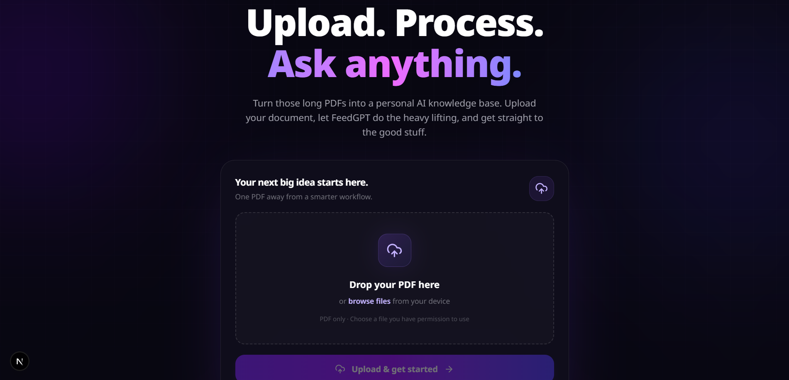
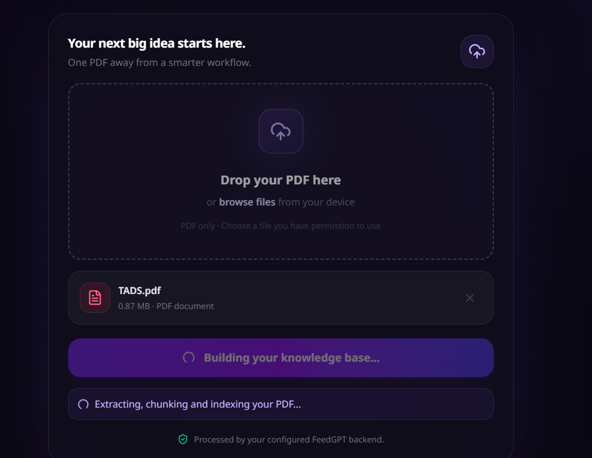
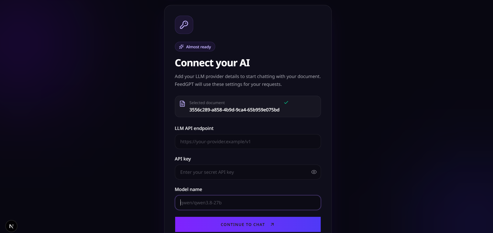
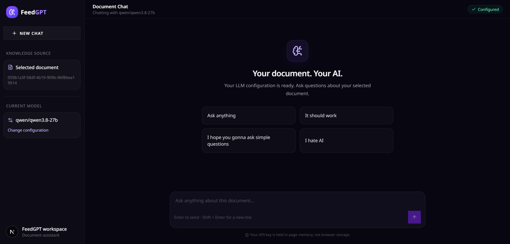
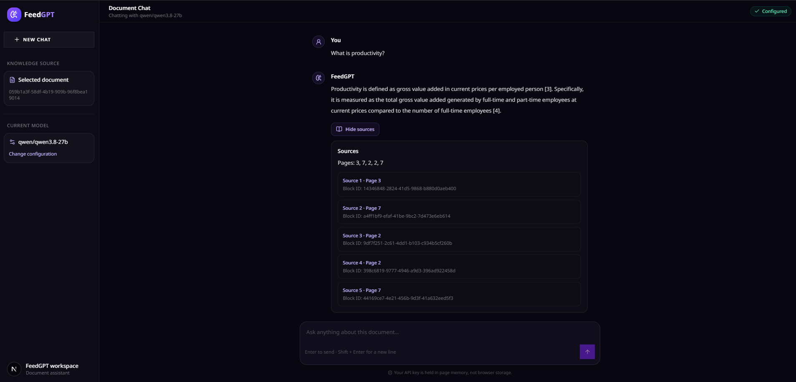
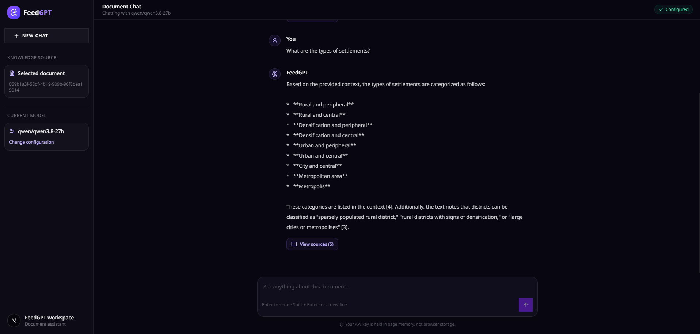
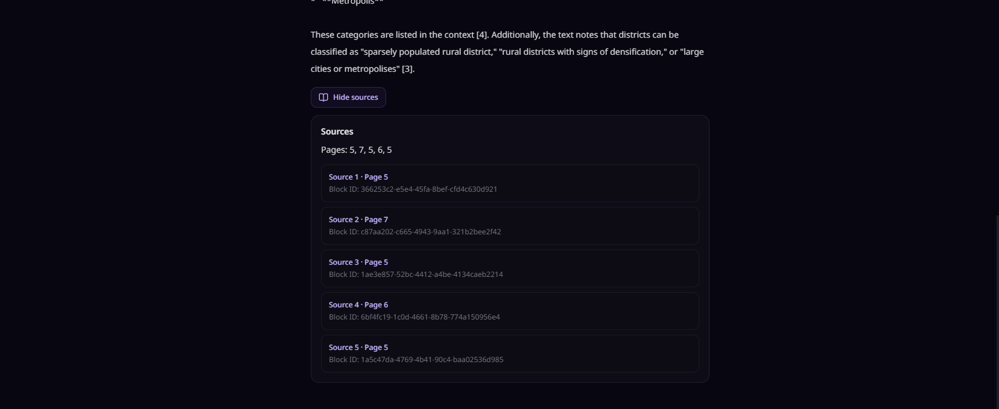
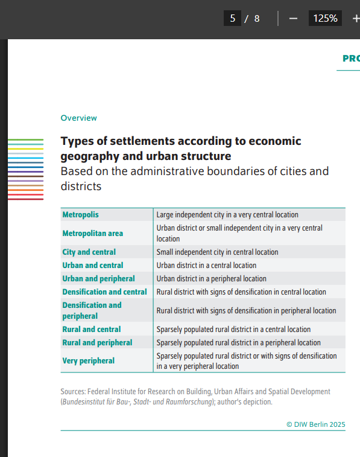
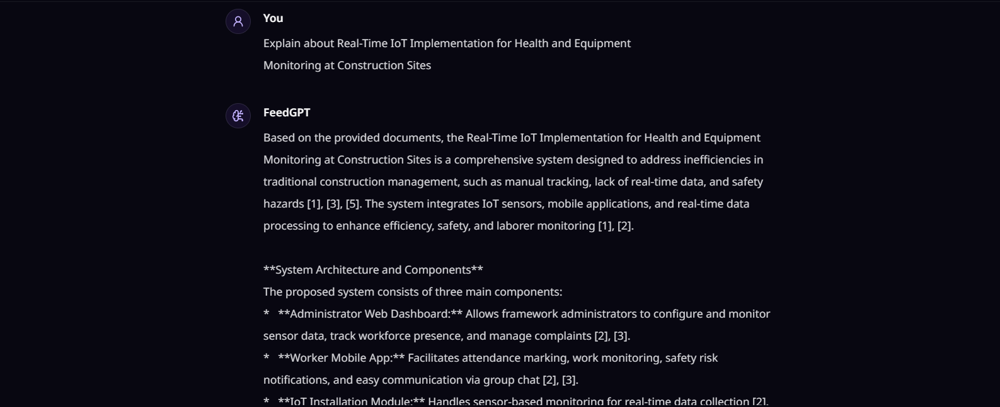

# FeedGPT 

> Upload a PDF. Ask it questions. Get answers with citations, streamed token by token.
> Built as a microservice RAG platform, coz comepetition here is soo muchh and tuff bro.

I built this to learn how a **production-style RAG system** actually works and how can I ship a product, not just "embed chunks, call an LLM". Async pipelines, idempotent workers, completion tracking, hybrid search, reranking, streaming.

It works. It definitely works end to end :)

---

## What it does

1. You upload a PDF.
2. The document is parsed, normalized, split into blocks and chunks and they are normalized, and sent out to **Postgres** (source of truth) and **Qdrant** (dense vectors + BM25 sparse vectors).
3. A state service tracks the document across every stage and tells the system when it is **fully processed**.
4. You ask a question. The retrieval service runs **hybrid search(Semantic + BM25 Sparse) → RRF → cross-encoder rerank**, builds a context, and streams the answer back over **SSE(Server Sent Events)** using *your own* LLM API key (OpenAI-compatible, tested with Groq).

---

## Architecture


## Output











### Services

| Service | Stack | Job |
|---|---|---|
| **Frontend** | Next.js, React, ShadCN | Upload, status, chat UI with streaming |
| **Backend API** | Fastify, Prisma | Accepts uploads, stores the PDF in MinIO, creates the document record, enqueues work |
| **Dispatcher** | BullMQ worker | Dispatches to Analyzer |
| **Analyzer** | | Parses the PDF using unstructured, streams blocks as NDJSON |
| **Data-Ingestion** | Fastify, BullMQ | Receives the stream, normalizes the blocks, batches blocks (500 per job), sends to the queues |
| **Block Ingestion Worker** | BullMQ | Idempotent upsert of blocks into Postgres |
| **Embedder Worker** | BullMQ, bge | Turns chunks into dense vectors |
| **Qdrant Worker** | BullMQ | Upserts dense + sparse (BM25) vectors |
| **State Manager** | Redis | Knows when a document is complete, partial, or failed |
| **Retrieval** | Python, FastAPI | Hybrid search, RRF, rerank, context building, SSE streaming |

---

## How retrieval works?

```
POST /chat
  → guards (LLM URL validation)
  → semantic search (bge query embedding, cached)  
  → BM25 search (sparse vectors in Qdrant)         
  → Reciprocal Rank Fusion (merge by rank)
  → cross-encoder rerank (BAAI/bge-reranker-base)
  → weak-retrieval check ("couldn't find this in the document")
  → context builder (dedupe, token budget, numbered citations)
  → LLM concurrency limiter + timeout
  → SSE stream to the client
```

- **BM25 lives in Qdrant as sparse vectors.** Terms are hashed (FNV-1a) and weighted with the BM25 formula at index time, and Qdrant applies IDF at query time. The tokenizer and hash must be identical anywhere sparse vectors are created or queried.
- **RRF merges by rank**, because cosine similarity and BM25 scores live on totally different scales.
- **The reranker is the slowest step**, so it runs in a single-worker thread pool (concurrent forward passes crashed my torch), with a timeout that falls back to RRF order. (Got so many Segmentation Fault tbh)
- **Bring your own LLM.** The frontend sends the API URL, key, and model. The key is used for that request only, never stored, never logged. The URL is validated to block requests to private addresses.
---

## Running it locally

> Fill in the exact commands and env vars for your setup before publishing. The skeleton is below.

**You need:** Docker, Node 20+, Python 3.11+, and an OpenAI-compatible LLM API key (Groq is free and fast).

```bash
git clone https://github.com//FeedGPT.git
cd FeedGPT
cd backend/infra/docker
docker compose up -d
# infra: Redis, Postgres, Qdrant, MinIO

# start each service (separate terminals, or Docker compose and other Dockerfiles needs to be tested so yea kindly understand)
# analyzer(python), data-ingestion, dispatcher, state manager,
# postgres worker, embedder worker, qdrant worker, api, retrieval(python), frontend
#For python u gotta do create venv and activate it and then pip install -r requirements.txt (Check notes.txt for the ports)
#Shit i will create .env.example
#For others, u gotta do npm i and then npm run dev
#Refer notes.txt
```

Then:
1. Open the frontend and upload a PDF.
2. Wait for the status to **COMPLETED**.
3. Paste your LLM base URL (e.g. `https://api.groq.com/openai/v1`), API key, and model name.
4. Ask something.

### Environment variables

| Variable | Used by | Notes |
|---|---|---|
| `REDIS_URL` | everything | Queues and BullMQ |
| `STATE_REDIS_URL` | state manager, workers | Redis holding the state sets |
| `DATABASE_URL` | API, Postgres worker | Prisma / Postgres |
| `QDRANT_URL` / `QDRANT_COLLECTION` | Qdrant worker, retrieval | Must match everywhere |
| `MINIO_*` | API, analyzer | Object storage for PDFs |

---

## What I learned
- Starting off with event-driven services
- ND/JSON Streaming
- Recursive + Sliding Window Chunking Technique
- BM25 Sparse Vector creation using FNV-1a
- Retrieval quality is mostly decided at ingestion
- SSE(Server Sent Events)
---

## Technology Stack
Frontend: Next.js, React, Typescript, Shadcn/ui, TailwindCSS
Backend: Node.js, Fastify, Python, FastAPI
Database & ORM: PostgreSQL, Qdrant, Prisma
Object Storage: MinIO
Queue & Messaging: Redis, BullMQ
Embedding & Reranking: Sentence Transformers, PyTorch, Xenova/bge-small-en-v1.5(Node compatible), BAAI/bge-small-en-v1.5(Python), BAAI/bge-reranker-base (Cross Encoder)
Containerization: Docker, Docker Compose

## End Note
On to the next oneeee (AI Inference!)
